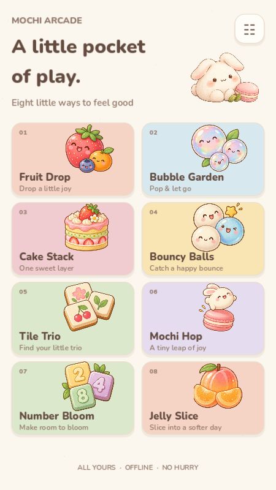
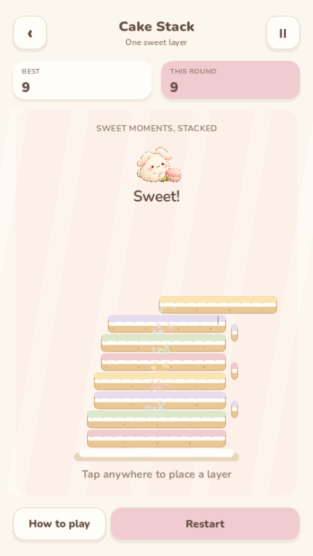
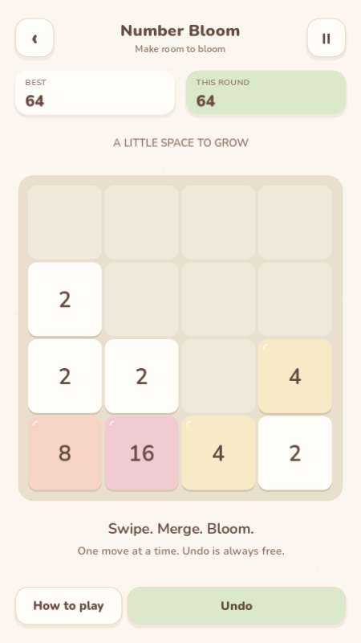

# Mochi Arcade

A cozy, offline collection of eight original 2D pocket games for Android.

**In development. No verified release is available yet.**

The shared app, Fruit Drop, Cake Stack and Number Bloom are playable in the current
development build. The remaining five games are in progress. Android installation
acceptance is pending an online device; a successful APK export alone is not
an installation test.

  
  
  

These are real desktop Godot viewport captures, not Android device screenshots.

| Game | Play |
| --- | --- |
| Fruit Drop | Drop and merge little fruits |
| Bubble Garden | Aim, bounce and clear connected bubbles |
| Cake Stack | Time each layer of a growing cake |
| Bouncy Balls | Catch balls with a paddle and multiply them |
| Tile Trio | Uncover tiles and collect matching trios |
| Mochi Hop | Hold, release and hop between sweet platforms |
| Number Bloom | Slide and merge a classic 2048 board |
| Jelly Slice | Swipe through jelly fruit in a gentle Zen mode |

Built with **Godot 4.7.2 stable**, GDScript and the Compatibility renderer.
The final Android artifact will be named **MochiArcade.apk**.

Development and release evidence is tracked in [the implementation plan](docs/IMPLEMENTATION_PLAN.md)
and [QA report](docs/QA_REPORT.md). Follow the verified [build instructions](docs/BUILD_AND_RELEASE.md)
for Godot import, tests and a development APK. All eight games will be available
from first launch in the finished collection.

Current checks: **14,278** logic assertions and **47** integration assertions,
including standard 2048 merges, seeded spawn distribution, cake overlap boundaries,
atomic-save recovery, undo with RNG restoration, lifecycle handling and 30 scene switches.
The [release checklist](docs/RELEASE_CHECKLIST.md) deliberately retains pending gates.
