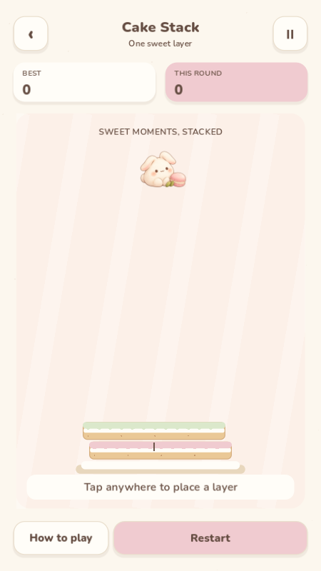
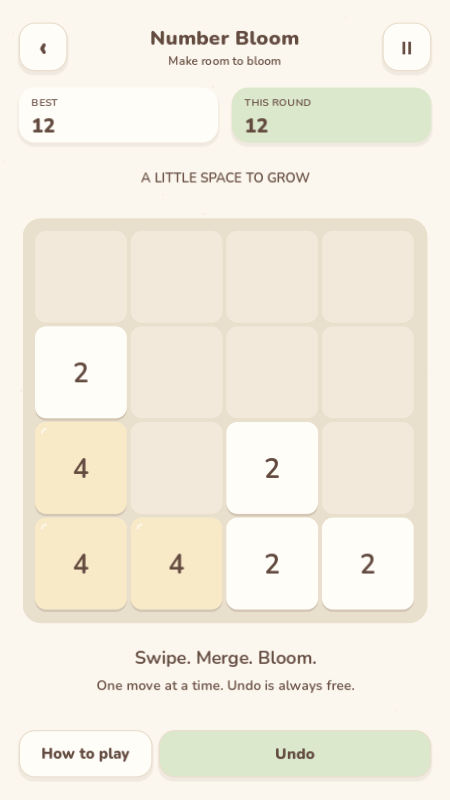

# Mochi Arcade

A cozy, offline collection of eight original 2D pocket games for Android.

**In development. No verified release is available yet.**

All eight games are playable in the current development build. A hosted Android 14 emulator installs and starts the development APK; full rendered
touch acceptance is still pending a software-renderer compatibility fix. No stable
release is published until the signed final APK passes that acceptance.

  
  
  

These are real desktop Godot viewport captures, not Android device screenshots.

| Game | Play |
| --- | --- |
| Fruit Drop | Drop and merge little fruits |
| Bubble Garden | Aim, bounce and clear connected bubbles |
| Cake Stack | Time each layer of a growing cake |
| Bouncy Balls | Catch balls with a paddle and multiply them |
| Tile Trio | Uncover tiles and collect matching trios |
| Mochi Hop | Hold, release and hop between sweet platforms |
| Number Bloom | Slide and merge a classic 2048 board |
| Jelly Slice | Swipe through jelly fruit in a gentle Zen mode |

Built with **Godot 4.7.2 stable**, GDScript and the Compatibility renderer.
The final Android artifact will be named **MochiArcade.apk**.

Development and release evidence is tracked in [the implementation plan](docs/IMPLEMENTATION_PLAN.md)
and [QA report](docs/QA_REPORT.md). Follow the verified [build instructions](docs/BUILD_AND_RELEASE.md)
for Godot import, tests and a development APK. All eight games are available
from first launch; no accounts, advertisements or purchases are required.

The required runner executes **18 suites**, including **934** collection lifecycle,
damaged-save and layout checks. A **34-screen** desktop matrix covers both languages
and three portrait ratios.

Game checks: **14,278** logic assertions and **47** integration assertions,
including standard 2048 merges, seeded spawn distribution, cake overlap boundaries,
atomic-save recovery, undo with RNG restoration, lifecycle handling and 30 scene switches.
Fruit adds **29** physics checks; Bubble adds **1,364** geometry/runtime checks and
a normal-action replay clearing five gardens before a natural loss and retry.
Mochi Hop validates **2,000 seeds / 50,000 platforms**, **47** input/lifecycle checks,
and a 40-hop input replay followed by a natural miss and restart.
Tile Trio independently solves **1,500 seeded boards** and verifies five consecutive
levels plus full-tray recovery through actual scene input.
Bouncy Balls reaches the real 64-ball cap during a four-wave input replay; sustained
pool stress and swept collisions have dedicated regression checks.
Jelly Slice verifies fast segment swipes, single-cut ownership and bounded fruit,
halves and trails; a 60-second actual-input replay slices 150 fruit and exercises
the voluntary Zen results and replay controls.
The [release checklist](docs/RELEASE_CHECKLIST.md) deliberately retains pending gates.
