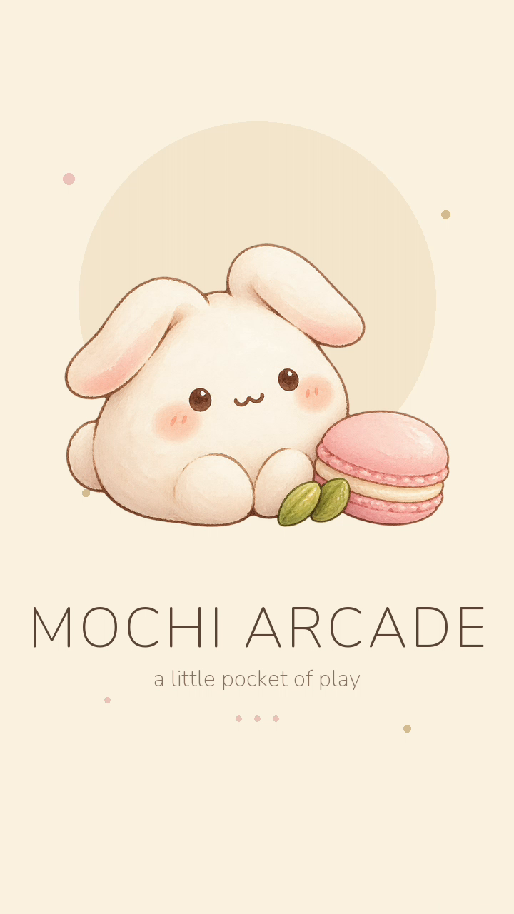
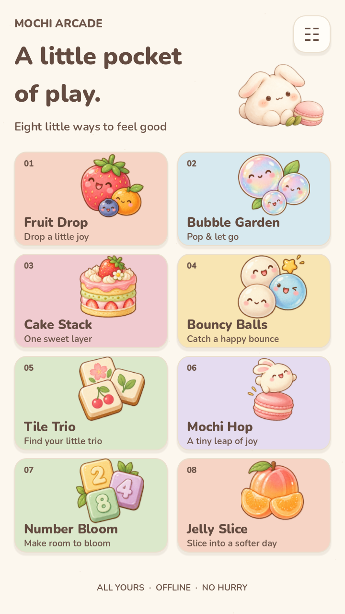
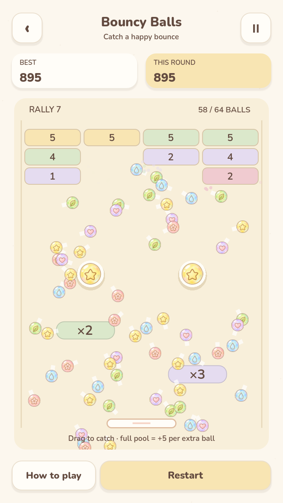

# Mochi Arcade

Eight cozy, fully offline pocket games in one portrait Android app.

[Download v1.0.0](https://github.com/seiya058904/mochi-arcade/releases/tag/v1.0.0) ·
[Release notes](docs/RELEASE_NOTES_v1.0.0.md) ·
[QA report](docs/QA_REPORT.md)

<p>
  
  
  
</p>

A cream-paper arcade of small, gentle games: drop fruit, pop bubbles, stack cake,
catch bouncy balls, match tiles, hop between platforms, merge numbers and slice
jelly. Each session lasts a few minutes. No accounts, ads, purchases, stamina,
network permissions or required tutorial.

Built with **Godot 4.7.2 stable**, GDScript and the Compatibility renderer.
The Android artifact is **MochiArcade.apk**, package
`io.github.seiya058904.mochiarcade`, version **1.0.0**.

## Games

| Game | Play |
| --- | --- |
| Fruit Drop | Drop and merge little fruits |
| Bubble Garden | Aim, bounce and clear connected bubbles |
| Cake Stack | Time each layer of a growing cake |
| Bouncy Balls | Catch balls with a paddle and multiply them |
| Tile Trio | Uncover tiles and collect matching trios |
| Mochi Hop | Hold, release and hop between sweet platforms |
| Number Bloom | Slide and merge a classic 2048 board |
| Jelly Slice | Swipe through jelly fruit in a gentle Zen mode |

## Verified for v1.0.0

- **18 required Godot suites: PASS**, with zero runtime errors; the suite includes
  995 collection lifecycle/damaged-save checks, 34 desktop visual-matrix screens,
  real-input playthroughs and bounded stress tests (see
  [QA report](docs/QA_REPORT.md) and [required checks](docs/evidence/required-checks.json)).
- **Signed-byte Android acceptance on a controlled hardware-GPU AVD** (AOSP API 34
  x86_64, Google AEHD 2.2, AMD Radeon RX 7900 XT, 720x1280): eight games x three
  background/foreground returns, 101 non-blank frames, same PID, pause checkpoint
  equality, force-stop round restore, zero-score restart, settings persistence,
  same-signature reinstall preserving the save, launcher icon, edge-target taps
  and first background-music loop. Maximum pools: 64 Balls at 55.43 presented FPS
  (p95 33.251 ms), Jelly Slice 12 fruit at 60.0 FPS (p95 17.243 ms), with exact
  save/backup restoration.
- **Custom Mochi Arcade startup experience**: the Android system splash uses the
  original bunny icon; the Godot boot splash is a cream Mochi Arcade image with
  the bunny and macaron. No Godot default logo, blue icon or default progress bar
  is shown, and no fake loading percentage or artificial delay is used. First
  launch 463 ms, cold start 408 ms, warm start 79 ms on the controlled AVD;
  screenshots and screen recordings are retained in
  [startup evidence](docs/evidence/android-api34-final-splash-2026-10-22/).
- **Security**: bounded static audit of the full reachable history and release
  working tree, no known credential-pattern findings and no runtime
  network/process calls.
- **Physical phone**: the owner reported a hands-on retest with no problems.
  Device metadata, captures and on-phone hashes were not supplied, so this remains
  subjective user evidence rather than automated physical-device acceptance.

### Disclosed limitation (owner-approved CI environment exception)

The GitHub-hosted Ubuntu + Mesa llvmpipe software-rendered Android emulator still
intermittently shows a blank frame after a background return
(`EGL_BAD_SURFACE`; a new surface cycle recovers the pause sheet with the same
PID). The raw failures are retained and the CI run is not reported as PASS. The
release owner approved a scoped A14 gate state of
`OWNER_APPROVED_ENVIRONMENT_EXCEPTION` for that hosted software-rendered case
only, using the hardware-GPU signed-byte acceptance above as substitute evidence.
No self-hosted GPU runner was added and no test assertion was removed.

Physical-phone quantitative performance (frame time, thermal, battery, refresh
rate) remains **UNVERIFIED**. Emulator compositor FPS is not phone FPS. See
[RELEASE_CHECKLIST.md](docs/RELEASE_CHECKLIST.md) and
[RELEASE_NOTES_v1.0.0.md](docs/RELEASE_NOTES_v1.0.0.md).

## Download and install

Download the signed APK and checksum from the
[v1.0.0 release](https://github.com/seiya058904/mochi-arcade/releases/tag/v1.0.0):

- `MochiArcade.apk`
- `SHA256SUMS`

```
SHA-256  8fcc1ebc83cb9cb8e8947a1a33bef9cba9222b9ac775fafdcd7d3d5cd85d473c
cert     de1458f30ad0f2a758b9c6f3de82c00b608723eaa75de22d3cf853e351f7657b
```

Requires Android 7.0+ (API 24), ARM64 or x86_64. Open the APK with Android's
package installer (allow installs from the file manager/browser when prompted).
Updates must keep the same package name and release signing identity to preserve
app data. The artifact is signed with the existing Mochi Arcade release
certificate (RSA-3072, v2+v3); the private key never enters this repository or
GitHub Actions secrets.

## Build and test

Use Godot **4.7.2 stable** with its matching official Android export templates,
JDK 17, Android SDK/Build Tools 36 and Python 3.12+. Set `MOCHI_GODOT` to the
engine executable. From PowerShell in the project root:

```powershell
./scripts_tools/godot.ps1 --headless --editor --import
python scripts_tools/run_checks.py --engine $env:MOCHI_GODOT
python scripts_tools/android_smoke.py --apk dist/MochiArcade.apk --output .local/android --serial emulator-5554 --release
python scripts_tools/android_load.py --apk dist/MochiArcade.apk --output .local/load --serial emulator-5554 --release
```

The signed release export uses `scripts_tools/sign_release.ps1 -Build` with the
protected local signing identity; see
[build and signing details](docs/BUILD_AND_RELEASE.md). Development APKs use a
debug identity and are not update releases.

## Custom boot splash

- `assets/art/boot-splash.png` (720x1280) is composed from the original
  `mochi-bunny.png` art with a procedural cream background and Nunito title.
- `project.godot` sets `application/boot_splash` to that image with
  `bg_color=#FBF3E2`, full-size and filtering enabled.
- `export_presets.cfg` sets cream splash/window background colors for the
  Godot 4.7.2 Android export path.
- No Godot logo, default progress bar, fake percentage or synthetic delay is used.

## Project layout

| Path | Purpose |
| --- | --- |
| `scenes/app`, `scripts/app` | Shared navigation, local saves and audio |
| `scenes/games`, `scripts/games` | Eight isolated scenes and their rules |
| `scripts/shared` | Input lifecycle, palette, feedback and geometry |
| `assets/art`, `assets/fonts` | Production art, boot splash and licensed fonts |
| `assets/source` | Image-generation prompts and concept provenance |
| `tests`, `scripts_tools` | Rules, input replays, visual/audio audits and build tools |
| `docs/evidence` | Actual reports and clearly labelled desktop/Android captures |

## Privacy and credits

Everything plays offline. There are no accounts, ads, purchases, analytics or
network permissions. Progress and preferences stay in local app storage. Settings
include music, sound, reduced motion, vibration, language and record reset.
Credits and bundled font/engine notices are readable offline inside the app.
See [asset provenance](docs/ASSET_PROVENANCE.md) for generated artwork and font
sources.

## License

Copyright (c) 2026 seiya058904. All rights reserved. See [LICENSE](LICENSE) for
the repository license and third-party notices. The app bundles Godot Engine
(MIT) and Nunito / Noto Sans SC (SIL OFL 1.1) notices; those components remain
under their own licenses.
