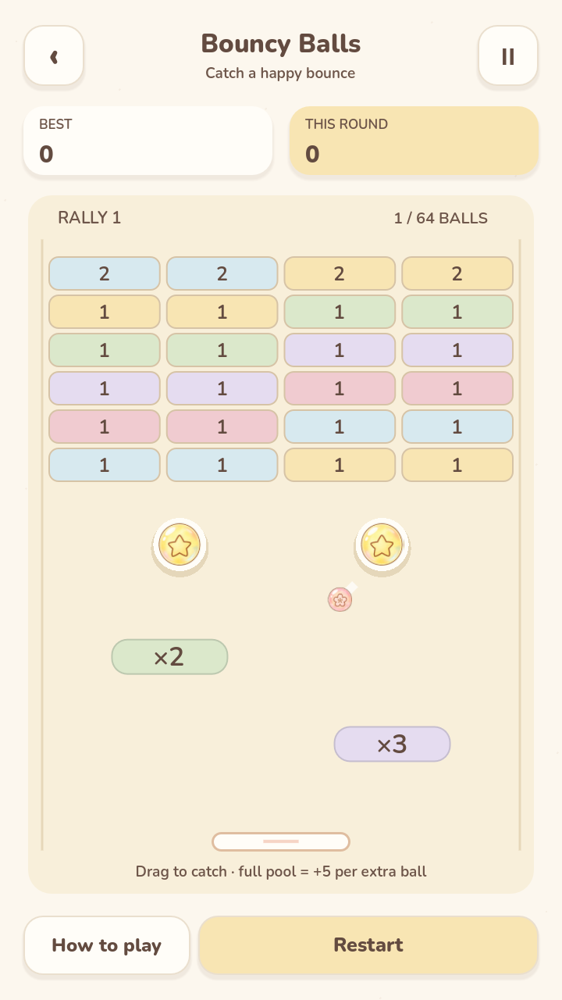
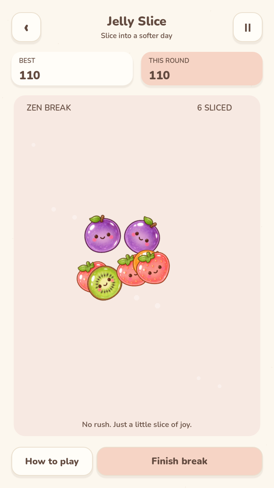
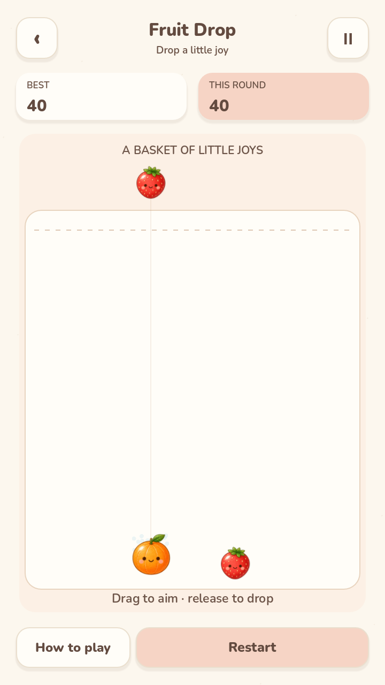
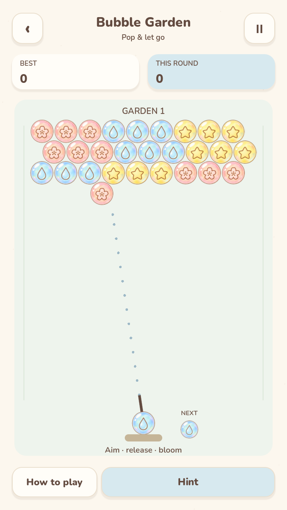
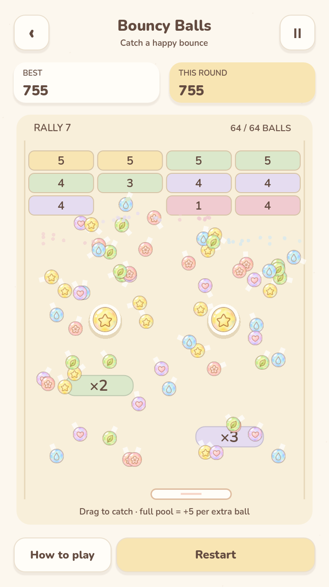
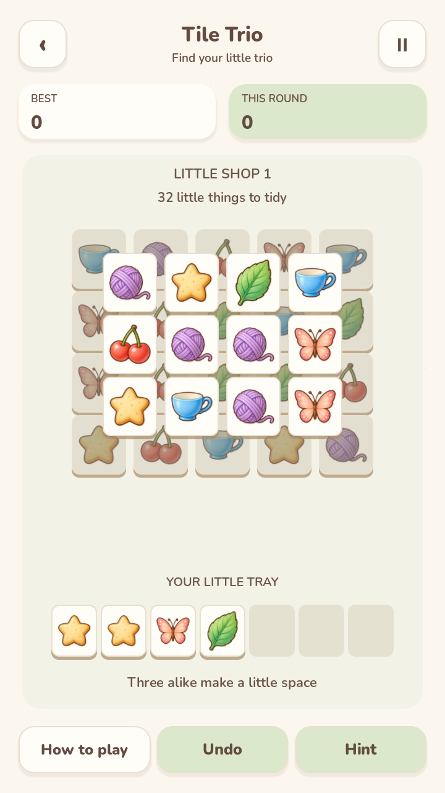
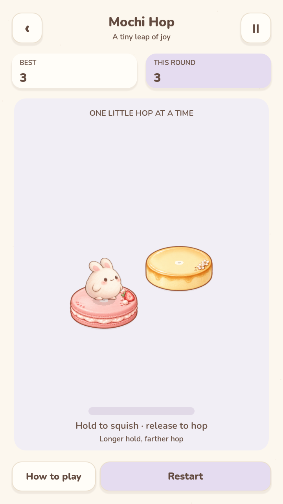

<p align="center">
  
</p>

<h1 align="center">Mochi Arcade</h1>

<p align="center">
  <strong>Eight little games. One softer place to play.</strong>
</p>

<p align="center">
  A cozy collection of bite-sized Android games, wrapped in pastel colors,<br />
  bouncy animations, and the kind of little moments you want to play again.
</p>

<p align="center">
  <a href="https://github.com/seiya058904/mochi-arcade/releases/latest"><strong>⬇ Download for Android</strong></a>
  &nbsp;·&nbsp;
  <a href="#meet-the-games">🎮 Meet the Games</a>
  &nbsp;·&nbsp;
  <a href="#a-peek-inside">📸 Screenshots</a>
  &nbsp;·&nbsp;
  <a href="#build-from-source">🛠️ Build from Source</a>
</p>

<p align="center">
  <sub>EIGHT MINI GAMES &nbsp;·&nbsp; ONE ANDROID APP &nbsp;·&nbsp; 100% OFFLINE &nbsp;·&nbsp; NO ADS OR ACCOUNTS</sub>
</p>

<p align="center">
  
  
  
</p>

<table>
  <tr>
    <td width="34%" align="center" valign="top">
      
      <br /><sub>ONE HAPPY LITTLE HOME</sub>
    </td>
    <td width="33%" align="center" valign="top">
      
      <br /><sub>BOUNCE INTO THE FUN</sub>
    </td>
    <td width="33%" align="center" valign="top">
      
      <br /><sub>SLICE A LITTLE JOY</sub>
    </td>
  </tr>
</table>

<p align="center"><sub>Actual in-game Android captures — not promotional mockups.</sub></p>

---

> **Sometimes, a few minutes of play is all you need.**
>
> Drop a fruit. Pop a bubble. Stack a cake. Send a little bunny flying. **Mochi Arcade** brings eight familiar, instantly playable ideas into one illustrated pocket playground. Start a round whenever you like, and put it down whenever you are ready.

<a id="meet-the-games"></a>
## 🎮 Meet the Games

Eight different ways to relax, all sharing the same gentle visual world.

<table>
  <tr>
    <td width="50%" valign="top">
      <h3>🍓 01 · Fruit Drop</h3>
      <p><sub>DROP · COLLIDE · MERGE</sub></p>
      <p>Let cheerful little fruits tumble into a bowl. Match two of a kind, watch them become something bigger, and see how far you can grow.</p>
    </td>
    <td width="50%" valign="top">
      <h3>🫧 02 · Bubble Garden</h3>
      <p><sub>AIM · BOUNCE · POP</sub></p>
      <p>Find your angle, bank a shot off the wall, and clear colorful clusters of bubbles. A small shot can make a whole garden fall.</p>
    </td>
  </tr>
  <tr>
    <td valign="top">
      <h3>🍰 03 · Cake Stack</h3>
      <p><sub>TIME · STACK · GROW</sub></p>
      <p>Tap at just the right moment to stack another sweet layer. Perfect placements build a streak; a tiny miss leaves a smaller cake.</p>
    </td>
    <td valign="top">
      <h3>🎱 04 · Bouncy Balls</h3>
      <p><sub>CATCH · RICOCHET · MULTIPLY</sub></p>
      <p>Guide bright bouncing balls through chunky bricks, bumpers, and real ×2/×3 multiplier gates. Watch one little rally turn into a cascade.</p>
    </td>
  </tr>
  <tr>
    <td valign="top">
      <h3>🧩 05 · Tile Trio</h3>
      <p><sub>UNCOVER · MATCH · CLEAR</sub></p>
      <p>Pick from layered picture tiles and collect matching sets of three. Uncover the next move, empty the tray, and clear the board.</p>
    </td>
    <td valign="top">
      <h3>🐰 06 · Mochi Hop</h3>
      <p><sub>HOLD · RELEASE · LAND</sub></p>
      <p>Help a squishy little bunny hop from treat to treat. Hold to charge, let go to jump, and aim for a satisfying perfect landing.</p>
    </td>
  </tr>
  <tr>
    <td valign="top">
      <h3>🌼 07 · Number Bloom</h3>
      <p><sub>SLIDE · MERGE · THINK AHEAD</sub></p>
      <p>Classic 2048, softened with colorful tiles and cheerful feedback. Make space, combine numbers, and chase a new personal best.</p>
    </td>
    <td valign="top">
      <h3>🍊 08 · Jelly Slice</h3>
      <p><sub>SWIPE · SLICE · UNWIND</sub></p>
      <p>Trace your finger through springy jelly fruit and enjoy a gentle chain of satisfying cuts. Zen play means no bombs and no countdown.</p>
    </td>
  </tr>
</table>

<a id="a-peek-inside"></a>
## 📸 A Peek Inside

These are real gameplay screens from Android testing. Each mini-game has its own rhythm, but the rounded shapes, soft colors, and calm presentation belong to the same little world.

<table>
  <tr>
    <td width="25%" align="center">
      <br />
      <sub><strong>Fruit Drop</strong></sub>
    </td>
    <td width="25%" align="center">
      <br />
      <sub><strong>Bubble Garden</strong></sub>
    </td>
    <td width="25%" align="center">
      <br />
      <sub><strong>Cake Stack</strong></sub>
    </td>
    <td width="25%" align="center">
      <br />
      <sub><strong>Bouncy Balls</strong></sub>
    </td>
  </tr>
  <tr>
    <td align="center">
      <br />
      <sub><strong>Tile Trio</strong></sub>
    </td>
    <td align="center">
      <br />
      <sub><strong>Mochi Hop</strong></sub>
    </td>
    <td align="center">
      <br />
      <sub><strong>Number Bloom</strong></sub>
    </td>
    <td align="center">
      <br />
      <sub><strong>Jelly Slice</strong></sub>
    </td>
  </tr>
</table>

<a id="made-for-little-breaks"></a>
## ✨ Made for Little Breaks

<table>
  <tr>
    <td width="50%" valign="top">
      <h3>☁️ A Softer Kind of Arcade</h3>
      <p>A cohesive pastel palette, original illustrated characters, gentle transitions, and little pops and bounces that make each move feel good.</p>
    </td>
    <td width="50%" valign="top">
      <h3>👆 Touch, Play, Repeat</h3>
      <p>Tap, swipe, drag, or hold. Every game is designed for short sessions and simple portrait-phone controls, without virtual joysticks or long tutorials.</p>
    </td>
  </tr>
  <tr>
    <td valign="top">
      <h3>🌱 No Pressure to Keep Up</h3>
      <p>No ads, accounts, purchases, energy timers, or online progression. Helpful undo and hint options are available where a puzzle needs them.</p>
    </td>
    <td valign="top">
      <h3>💾 Your Pocket, Your Progress</h3>
      <p>Records and settings stay on your device. Pause a round, come back later, and keep your eight little worlds independent of one another.</p>
    </td>
  </tr>
</table>

The app includes **English and Simplified Chinese**, separate music and sound controls, vibration preferences, reduced-motion settings, and offline credits and license information.

<a id="download"></a>
## 📱 Download & Play

<p>
  <a href="https://github.com/seiya058904/mochi-arcade/releases/latest"><strong>⬇ Get the latest Android APK →</strong></a>
  &nbsp; · &nbsp;
  <a href="https://github.com/seiya058904/mochi-arcade/releases">All releases</a>
</p>

1. Open **[GitHub Releases](https://github.com/seiya058904/mochi-arcade/releases/latest)** and download `MochiArcade.apk` from the release assets.
2. Open the APK on your Android phone and follow the system's installation prompt.
3. Launch **Mochi Arcade**, choose a game, and play offline.

**Requirements:** Android **7.0 or newer** (API 24+), with an `arm64-v8a` or `x86_64` device. The APK is a native Android build, not a WebView or a browser game.

> [!NOTE]
> Updates must use the **same Android package and signing identity** to preserve an existing installation. Progress is stored locally, not in the cloud. Uninstalling or clearing app data may remove your records; back up anything important before doing so.

<a id="under-the-hood"></a>
## 🛠️ Under the Hood

<p align="center">
  <sub>GODOT 4.7.2 STABLE &nbsp;·&nbsp; GDSCRIPT &nbsp;·&nbsp; 2D COMPATIBILITY RENDERER &nbsp;·&nbsp; ANDROID</sub>
</p>

Eight isolated game scenes share one lightweight application shell for navigation, settings, audio, input lifecycle, and local save management. Game rules remain independently testable.

<a id="build-from-source"></a>
<details>
<summary><strong>⚙️ Build from Source</strong></summary>

### Requirements

- **Godot 4.7.2 stable** and matching official Android export templates
- **JDK 17**
- **Android SDK / Platform & Build Tools 36**, plus platform-tools
- **Python 3.12+** for the test runner

Set the `MOCHI_GODOT` environment variable to the Godot executable. In **PowerShell**, from the repository root:

```powershell
./scripts_tools/godot.ps1 --headless --editor --import
python scripts_tools/run_checks.py --engine $env:MOCHI_GODOT
./scripts_tools/godot.ps1 --headless --export-debug Android dist/MochiArcade-dev.apk
```

The development APK is **debug-signed** and is not interchangeable with the official signed release. The release signing identity is intentionally kept outside this repository.

For setup, release signing and device verification, see [Build & Release](docs/BUILD_AND_RELEASE.md).

</details>

<details>
<summary><strong>🗂️ Explore the Project</strong></summary>

```text
assets/art/        Original characters, game artwork, icons
assets/fonts/      Bundled typefaces and OFL license notices
scenes/app/        Shared Android-facing application scene
scenes/games/      Eight independent mini-game scenes
scripts/app/       Navigation, audio, saves and settings
scripts/games/     Gameplay logic and game-specific drawing
scripts/shared/    Common geometry, palette and feedback
tests/             Rules, procedural boards, interaction replays
scripts_tools/     Build, Android smoke tests and QA utilities
docs/              Product, art direction, QA and release evidence
```

**Documentation:** [Design Bible](docs/DESIGN_BIBLE.md) · [Product Scope](docs/PRODUCT.md) · [QA Report](docs/QA_REPORT.md) · [Release Checklist](docs/RELEASE_CHECKLIST.md) · [Asset Provenance](docs/ASSET_PROVENANCE.md)

</details>

### Verification, Without Guesswork

The repository includes **19 required automated test suites** (the original 18 plus save-failure and terminal-Undo regressions), deterministic game replays, procedural-board checks, and retained Android screenshots and lifecycle evidence.

The published **v1.0.0** signed APK was exercised on a controlled **Android 14 / API 34 hardware-GPU emulator**, including all eight games, background return, resume, restart, save restoration, and maximum-object loads. This is **not** a claim that every Android phone will achieve the same frame rate.

The **1.1.0 source iteration is not released**: it adds save-failure feedback and recovery, Number Bloom Undo from the result screen, and fewer idle canvas rebuilds. The exact original-signature APK has passed hosted API 34 runtime and in-place upgrade acceptance; final startup/CI review and publication are pending. [Iteration status and evidence](docs/ITERATION_1.1.md) distinguish these gates from the published v1.0.0 evidence; the download links above continue to serve the accepted release.

A dedicated cream **Mochi Arcade boot splash** replaces the default engine splash; first launch (463 ms), cold start (408 ms) and warm start (79 ms) were captured on the emulator with no Godot default logo, blue icon, progress bar, fake percentage or artificial delay. See the [startup evidence](docs/evidence/android-api34-final-splash-2026-10-22/).

The GitHub-hosted **software-rendered** Android emulator has also reproduced an intermittent blank frame on background return. Its failed runs are preserved, with a narrowly scoped, documented owner-approved environment exception rather than a claim that those runs passed. See the [QA Report](docs/QA_REPORT.md) and [Release Checklist](docs/RELEASE_CHECKLIST.md) for precise status and limitations.

## 🔒 Privacy & Local Saves

Mochi Arcade is designed for offline play. It asks for **no account**, contains **no ads or analytics**, and does not request the Android Internet permission. The packaged app requests **vibration permission only**.

Your preferences, progress, and high scores are stored locally on your device. There is no cross-device synchronization or account-based recovery.

## 🎨 Artwork, Sound & Credits

Mochi Arcade combines **original project illustrations and icons**, bespoke 2D drawing and animation, and **locally synthesized background music and sound effects**. Artwork sources, image-generation prompts, and production usage are documented in [Asset Provenance](docs/ASSET_PROVENANCE.md).

The app uses **Nunito** and **Noto Sans SC** under the **SIL Open Font License**, alongside the Godot engine and its applicable notices. Credits and third-party license information are available inside the app without an internet connection.

This public repository does **not** declare a blanket license for its original code, illustrations, or sound. Public visibility alone does not grant permission to copy, redistribute, or relicense those original assets. See [LICENSE](LICENSE) for the repository license; third-party components remain under their own licenses.

---

<p align="center">
  <strong>A little bounce. A little pop. A little break.</strong><br />
  <sub>Mochi Arcade · Eight cozy games in one pocket.</sub>
</p>
