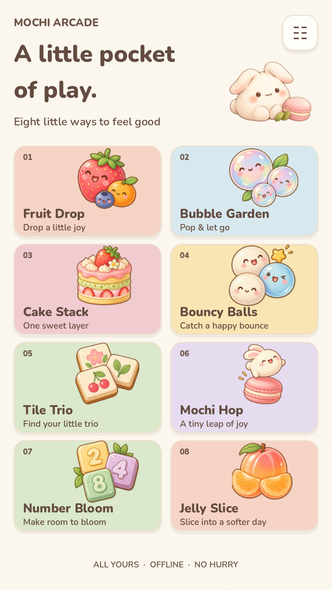
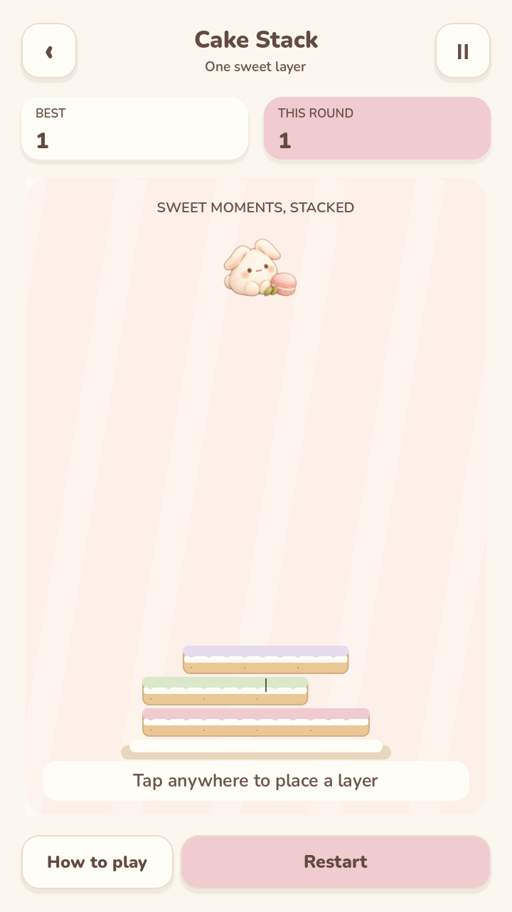
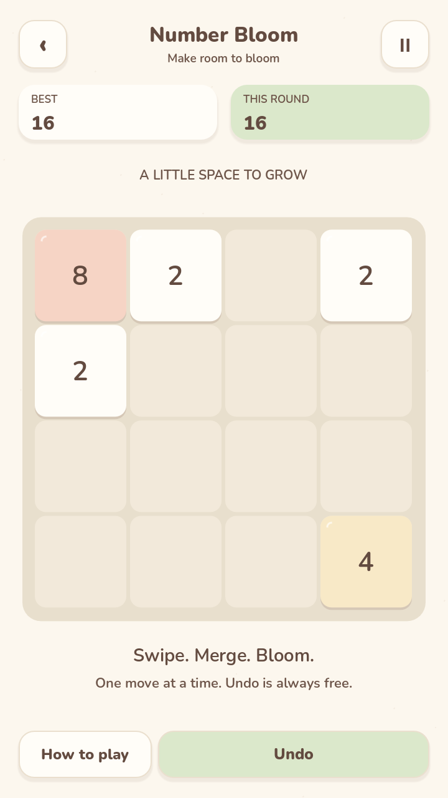

# Mochi Arcade

A cozy, offline collection of eight original 2D pocket games for Android.

**In development. No verified release is available yet.**

All eight games are playable in the current development build. A hosted Android 14
emulator completed all eight games' touch, pause, round restore and restart checks,
plus settings persistence and same-signature reinstall. A later run reproduced an
intermittent black screen on background return, which remains a release blocker.
A host-GLES software comparison now passes the full Android path and visual review;
a later repeated-return run passes all 24 returns but the disposable emulator goes
offline during the maximum-load phase. The newest runs pass the expanded edge-target taps and execute both maximum pools
on one online emulator (64 Balls at 3.60-3.84 FPS, 12 Jelly fruit at 5.04-7.19 FPS
on software rendering; not phone performance). They also retain three Android
failures: a test-harness timing assumption at a second Bouncy Balls return (now
fixed) and, more importantly, fully black Fruit Drop background returns in two
separate sessions that only a new surface cycle recovers with the same PID. That
surface failure is a reproducible release blocker; repeated stability, performance
and final signed-APK acceptance remain open.

The user's own phone playtest reported one P1 issue: Bouncy Balls' ball, bricks and
mid-field multiplier gates/bumpers were too small (the paddle was explicitly fine).
The current build enlarges those play-field objects and keeps the paddle unchanged;
measured before/after evidence is in [playtest feedback](docs/PLAYTEST_FEEDBACK.md).

<p>
  
  
  
</p>

Actual Android 14 emulator captures at 720x1280, reviewed alongside 84 other
native captures. This is development-build evidence, not a physical-phone performance claim.

| Game | Play |
| --- | --- |
| Fruit Drop | Drop and merge little fruits |
| Bubble Garden | Aim, bounce and clear connected bubbles |
| Cake Stack | Time each layer of a growing cake |
| Bouncy Balls | Catch balls with a paddle and multiply them |
| Tile Trio | Uncover tiles and collect matching trios |
| Mochi Hop | Hold, release and hop between sweet platforms |
| Number Bloom | Slide and merge a classic 2048 board |
| Jelly Slice | Swipe through jelly fruit in a gentle Zen mode |

Built with **Godot 4.7.2 stable**, GDScript and the Compatibility renderer.
The final Android artifact will be named **MochiArcade.apk**.

Development and release evidence is tracked in [the implementation plan](docs/IMPLEMENTATION_PLAN.md)
and [QA report](docs/QA_REPORT.md). Follow the verified [build instructions](docs/BUILD_AND_RELEASE.md)
for Godot import, tests and a development APK. All eight games are available
from first launch; no accounts, advertisements or purchases are required.

The required runner executes **18 suites**, including **995** collection lifecycle,
damaged-save and layout checks. A **34-screen** desktop matrix covers both languages
and three portrait ratios.

Game checks: **14,288** logic/audio-boundary assertions and **47** integration assertions,
including standard 2048 merges, seeded spawn distribution, cake overlap boundaries,
atomic-save recovery, undo with RNG restoration, lifecycle handling and 30 scene switches.
Fruit adds **29** physics checks; Bubble adds **1,364** geometry/runtime checks and
a normal-action replay clearing five gardens before a natural loss and retry.
Mochi Hop validates **2,000 seeds / 50,000 platforms**, **47** input/lifecycle checks,
and a 40-hop input replay followed by a natural miss and restart.
Tile Trio independently solves **1,500 seeded boards** and verifies five consecutive
levels plus full-tray recovery through actual scene input.
Bouncy Balls reaches the real 64-ball cap during a four-wave input replay; its
236,607 checks include layout-scale invariants after the playtest revision, plus
sustained pool stress and swept collisions.
Jelly Slice verifies fast segment swipes, single-cut ownership and bounded fruit,
halves and trails; a 60-second actual-input replay slices 150 fruit and exercises
the voluntary Zen results and replay controls.
The [release checklist](docs/RELEASE_CHECKLIST.md) deliberately retains pending gates.

## Build and test

Use Godot **4.7.2 stable** with its matching official Android export templates,
JDK 17, Android SDK/Build Tools 36 and Python 3.12+. Set `MOCHI_GODOT` to the
engine executable. From PowerShell in the project root:

```powershell
./scripts_tools/godot.ps1 --headless --editor --import
python scripts_tools/run_checks.py --engine $env:MOCHI_GODOT
./scripts_tools/godot.ps1 --headless --export-debug Android dist/MochiArcade-dev.apk
```

The test runner fails on script/runtime errors even if Godot exits with code zero.
Development APKs use a debug identity; they are not long-term update releases.
See [build and signing details](docs/BUILD_AND_RELEASE.md) for the private release
identity, actual Android acceptance status and final publication gates.

## Project layout

| Path | Purpose |
| --- | --- |
| `scenes/app`, `scripts/app` | Shared navigation, local saves and audio |
| `scenes/games`, `scripts/games` | Eight isolated scenes and their rules |
| `scripts/shared` | Input lifecycle, palette, feedback and geometry |
| `assets/art`, `assets/fonts` | Production art and licensed fonts |
| `assets/source` | Image-generation prompts and concept provenance |
| `tests`, `scripts_tools` | Rules, input replays, visual/audio audits and build tools |
| `docs/evidence` | Actual reports and clearly labelled desktop/Android captures |

## Privacy and credits

Everything plays offline. There are no accounts, ads, purchases, analytics or
network permissions. Progress and preferences stay in local app storage. Settings
include music, sound, reduced motion, vibration, language and record reset.
Credits and bundled font/engine notices are readable offline inside the app.
See [asset provenance](docs/ASSET_PROVENANCE.md) for generated artwork and font sources.

## Install and releases

**No stable release is currently published.** The final accepted asset will be named
`MochiArcade.apk`. This repository is private, so its releases require repository
access. When a verified release is available, download that APK to an Android
7.0+ ARM64 or x86_64 device and open it with Android's package installer. Updates
must retain the same package and release signing identity to preserve app data.
Physical-device performance remains unverified until tested on a phone.
